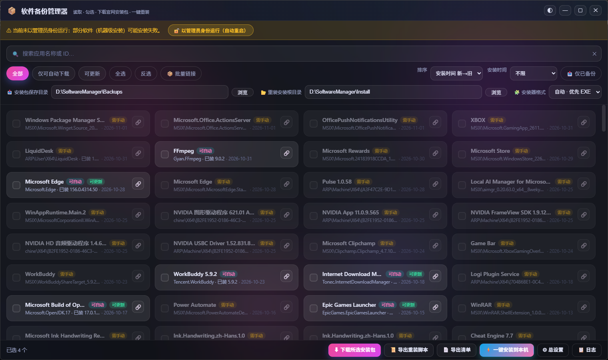
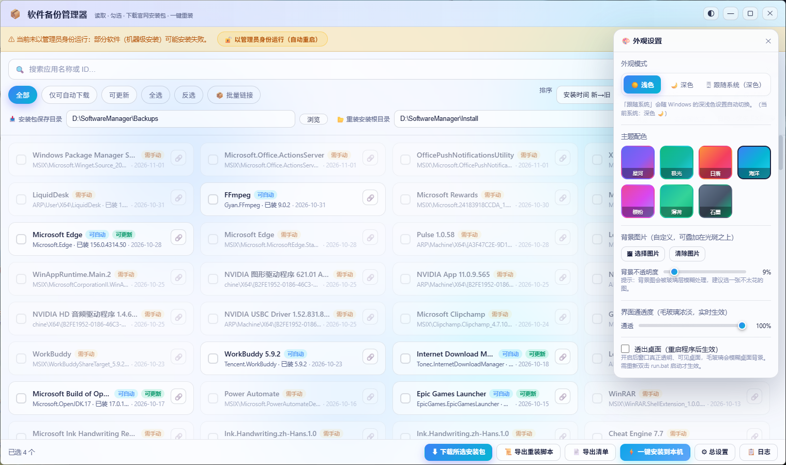

<div align="center">

# 📦 软件备份管理器

**Software Backup Manager**

读取本机已装应用 → 勾选 → 下载官网安装包 → 导出一键重装脚本

重装系统后，每个软件自动装进「安装根目录 / 软件名」的独立子文件夹。

[](https://www.python.org/)
[](https://pywebview.flowrl.com/)
[](https://learn.microsoft.com/windows/package-manager/)
[](LICENSE)

</div>

---

## 📸 截图

<div align="center">

<p><sub>主界面：搜索、筛选、排序、批量勾选</sub></p>
</div>

<div align="center">

<p><sub>外观设置：浅色 / 深色 / 跟随系统，7 套主题配色</sub></p>
</div>

> 截图放到 `docs/` 目录，没有的话删掉上面两段即可。

---

## ❓ 这东西解决什么问题

**场景**：攒了三年的一堆软件，重装系统后一个个去找官网下载？

**做法**：

1. 打开本工具，自动列出你电脑上所有已安装的软件（读 `winget list` + 注册表）
2. 勾上你要的，点「⬇ 下载所选安装包」——直接从 winget 官网源把**最新安装包**下载到本地
3. 点「📜 导出重装脚本」——生成一个 `重装全部.bat`
4. 换新系统时双击这个 bat，所有软件自动装好，**每个软件一个独立文件夹**，互不打架

**不需要的**：装什么用什么，干净系统。

---

## ✨ 功能特性

### 📥 下载与备份

- **自动读取已装软件**：合并 `winget list` 与注册表 `Uninstall` 键，覆盖率实测 **118/207**（其余主要是 Microsoft Store 应用）
- **智能选择安装器**：同一个软件常常同时提供 `exe / msi / zip` 好几个变体，全下就是白白多占几百 MB。工具按「文件形态」分组，**命中第一个就停手**：

  | 形态 | 候选类型（按序尝试） |
  |---|---|
  | EXE | `exe` → `nullsoft` → `inno` → `burn` |
  | MSI | `msi` → `wix` → `msp` |
  | ZIP | `zip` |
  | MSIX | `msix` → `appx` |

- **安装器格式可自选**：下拉框切换「自动·优先 EXE / 优先 MSI / 优先 ZIP / 全部变体」
- **下载包自动回关联**：下过的包记进 `backup_index.json`，卡片上显示绿色「已备份」徽标；一键安装和导出脚本会**优先用本地包离线装**，不联网
- **静默安装参数按类型分发**：

  | 类型 | 命令 |
  |---|---|
  | MSI / WiX | `msiexec /i "..." /qn /norestart INSTALLDIR="..."` |
  | Inno Setup | `"..." /VERYSILENT /SUPPRESSMSGBOXES /NORESTART` |
  | Burn 引导 | `"..." /quiet /norestart` |
  | NullSoft | `"..." /S` |

### 🔍 筛选与排序

- **排序**：名称 A→Z / Z→A、安装时间 新→旧 / 旧→新、版本 新→旧、包大小 大→小
- **安装时间范围**：近 7 / 30 / 90 天、近半年、近一年、一年以前、有日期的、未知日期
- **安装时间来源**：注册表 `InstallDate`（`20261011` 与 Unix 时间戳两种格式统一归一化成 Unix 秒），缺失时回退到安装目录创建时间
- **「📥 仅已备份」**：一键筛出本地已有安装包的软件
- 另有「全部 / 仅可自动下载 / 可更新」筛选 + 搜索框 + 全选 / 反选
- 未知日期的条目在日期排序中**始终沉底**，不会插到最前面

### 🪟 窗口

- **无边框毛玻璃**窗口，自绘 8 向缩放手柄（无边框会清掉系统缩放热区，所以自己画）
- **拖动与缩放**：Win32 原生 `GetCursorPos + SetWindowPos` 实现
- **位置/大小记忆**：关掉再开回到原位；拔了显示器会自动拉回可见区域
- **最大化 / 还原**按钮 + 快捷键
- **不弹黑框**：winget 与安装器子进程用 `CREATE_NO_WINDOW` 抑制控制台，提权走 `pythonw.exe`

### 🎨 外观

- **浅色 / 深色 / 跟随系统**（跟随系统直接读注册表 `AppsUseLightTheme`，2.5s 轮询兜底）
- **7 套主题配色**：星河 / 极光 / 日落 / 海洋 / 樱粉 / 薄荷 / 石墨
- 自定义**背景图片**、背景不透明度、界面通透度
- **透出桌面**：窗口真透明 + 毛玻璃模糊桌面背景（需重启程序生效）

### 📋 其它

- **导出清单**：CSV 或 TXT，含名称 / ID / 版本 / 安装日期 / 安装位置 / 来源 / 安装包路径 / 安装命令
- **批量链接**：一次选多个安装包，按文件名自动匹配到对应软件
- **手动指定安装参数**：右键卡片可改静默安装命令行
- **勾选记忆**：关掉再开，勾选状态还在
- **运行日志**面板，实时看下载 / 安装进度

---

## 🚀 快速开始

### 方式一：直接下载 exe（推荐）

Releases 页下载 `SoftwareManager.exe`，双击即用，免安装。

### 方式二：源码运行

```bash
git clone https://github.com/22759/software-backup-manager.git
cd software-backup-manager

pip install -r requirements.txt
python app.py
```

**环境要求**：

| 项 | 要求 |
|---|---|
| 操作系统 | Windows 10 1809+ / Windows 11 |
| Python | 3.9+（开发用 3.14） |
| 运行时 | [Microsoft Edge WebView2 Runtime](https://developer.microsoft.com/microsoft-edge/webview2/)（Win11 自带，Win10 需装）、[App Installer](https://apps.microsoft.com/detail/9nblggh4nns1)（提供 winget） |
| 权限 | 部分机器级安装需要**管理员**（工具内有一键提权按钮） |

### 方式三：打包成 exe

```bash
pip install pyinstaller
pyinstaller --noconfirm --onefile --windowed ^
  --name SoftwareManager ^
  --icon icon.ico ^
  --add-data "web;web" ^
  app.py
```

产物在 `dist/SoftwareManager.exe`（约 22 MB，单文件）。

---

## 📂 目录结构

```
software-backup-manager/
├── app.py                  # 后端：winget 调用、注册表采集、下载/安装/导出、Win32 窗口控制
├── web/
│   ├── index.html          # 界面结构
│   ├── style.css           # 毛玻璃 + 主题变量 + 响应式
│   └── app.js              # 交互：渲染、筛选、排序、弹窗、右键菜单
├── icon.ico                # 程序图标
├── requirements.txt
├── run.bat                 # 一键启动（优先跑打包好的 exe，缺依赖自动 pip install）
├── build.bat               # 一键打包
├── docs/                   # 截图
├── LICENSE
└── README.md
```

---

## ⚙️ 运行时数据

程序在 **exe 同目录**（源码运行时是脚本同目录）读写这些文件：

| 文件 | 作用 |
|---|---|
| `settings.json` | 外观、主题、两个目录、排序、筛选、安装器格式、窗口矩形 |
| `install_links.json` | 手动链接的本地安装包（按 winget id） |
| `selection.json` | 勾选记忆 |
| `backup_index.json` | 已下载安装包索引（winget id → 本地文件） |

> 这些都已在 `.gitignore` 里，不会被提交。

---

## 🔧 工作原理

```
winget list ──┐
              ├─→ 合并去重 ─→ 注册表补充安装时间/位置/发布者 ─→ 卡片列表
注册表 Uninstall ─┘

勾选 ─→ winget download ─→ 按安装器类型分组筛选 ─→ 存入备份目录 ─→ 写 backup_index.json

导出重装脚本时按来源分流：
  ├─ local  (手动链接的包)  → 复制进备份目录，脚本里写死命令行
  ├─ backup (已下载的包)    → 脚本里用 %BACKUP% 相对路径，离线安装
  └─ winget (啥都没有)      → 脚本里调 winget install
```

---

## ❓ 常见问题

**Q：`winget` 找不到 / 报错？**
A：装 [App Installer](https://apps.microsoft.com/detail/9nblggh4nns1)，或在设置里确认 `%LOCALAPPDATA%\Microsoft\WindowsApps\winget.exe` 存在。

**Q：窗口点不动 / 拖不动？**
A：pywebview 6.x 没有 `start_drag()`，本项目用 Win32 自绘实现。若仍异常，先删掉同目录 `settings.json` 里的 `windowRect` 复位。

**Q：日期排序为什么有些软件没日期？**
A：Microsoft Store 应用（MSIX）通常没有注册表 `InstallDate`。这类在日期排序中沉底，用「未知日期」筛选可单独看。

**Q：下载下来的 `.yaml` 是什么？**
A：`winget download` 会附带一份合并 manifest，记录下载地址、SHA256、安装器类型、ProductCode、静默安装参数。真正的安装包是同目录的 `.msi` / `.exe`。

**Q：为什么装完还想要独立文件夹？**
A：避免不同软件装到同一目录互相覆盖，也方便日后整体搬走或卸载。

---

## ⚠️ 免责声明

本工具调用 `winget` 官方源下载安装包，并按各安装器类型传入**通用**静默参数。个别软件的静默开关是自定义的，可能安装失败——这时请手动运行对应安装包。下载的安装包版权归原软件作者所有，本仓库不分发任何安装包。

---

## 📄 License

[MIT](LICENSE) © 2026 Software Backup Manager Contributors

---

## 🙏 致谢

- [winget](https://learn.microsoft.com/windows/package-manager/) —— 微软官方包管理器
- [pywebview](https://pywebview.flowrl.com/) —— Python 里的 WebView 封装
- [WebView2](https://developer.microsoft.com/microsoft-edge/webview2/) —— 渲染引擎
- [uiverse.io](https://uiverse.io/) —— 界面与组件灵感来源（毛玻璃卡片、玻璃按钮、渐变光斑背景）
